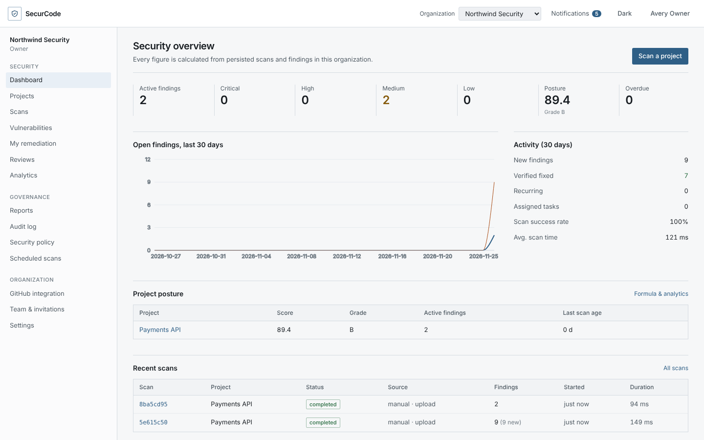
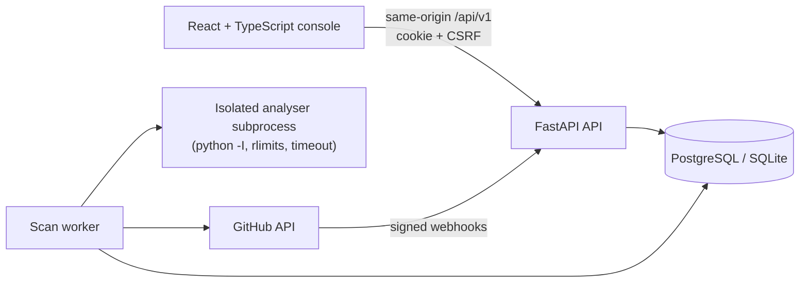
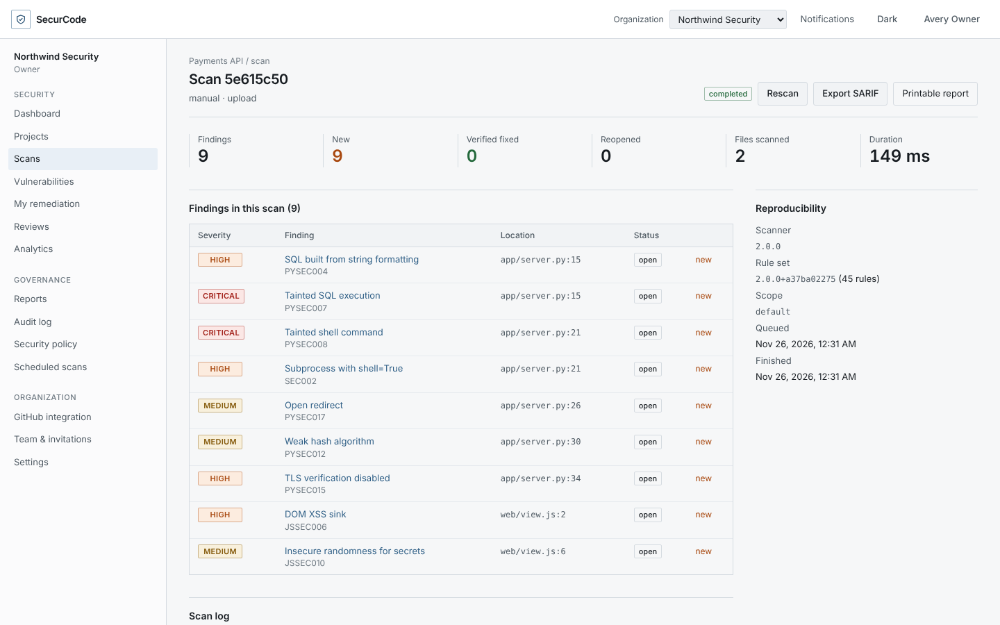
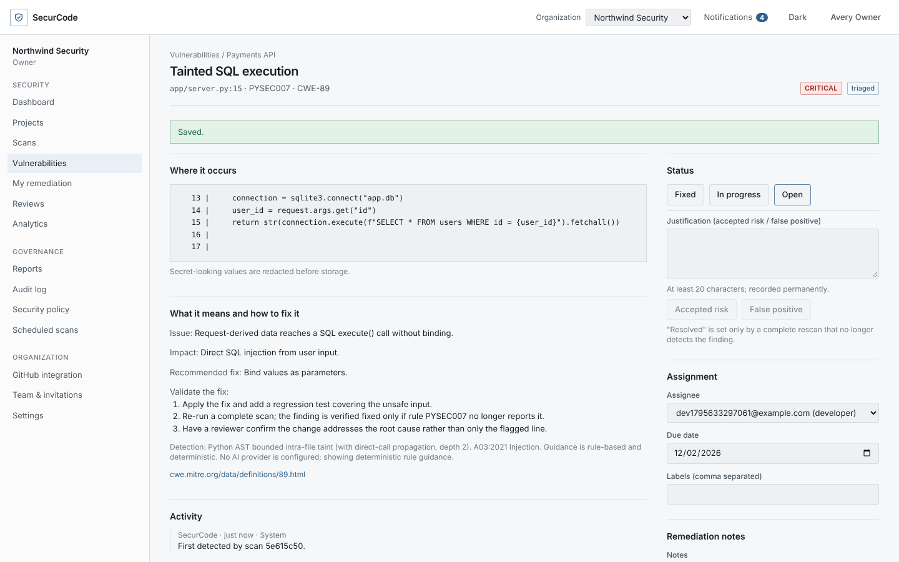
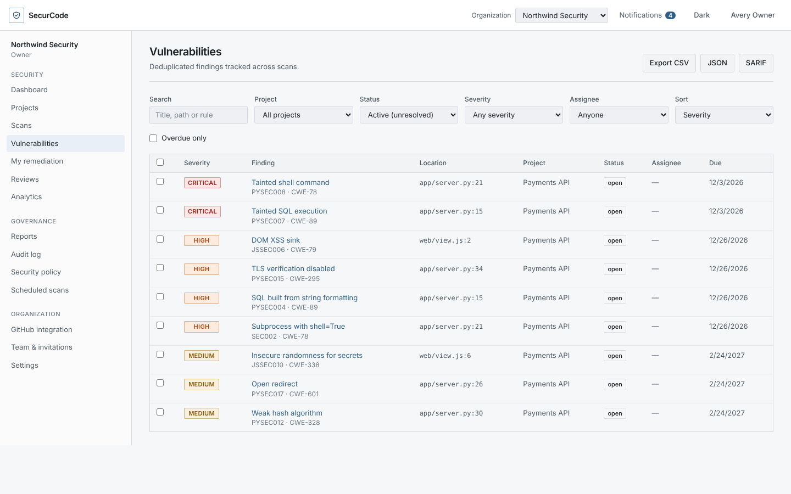
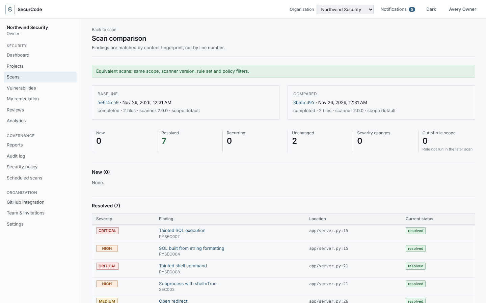

# SecurCode

**Multi-tenant application security and vulnerability management platform.** Teams register, create organisations, invite members, connect code (archive upload or GitHub), run isolated static analysis in a background worker, then triage, assign and remediate findings. A fix counts as verified only after a complete rescan stops detecting it.



> **Status (November 2026):** feature-complete for local and self-hosted use, with automated evidence below. **Not yet publicly deployed**: deploying needs your Render/Vercel/database accounts ([guide](docs/deployment/DEPLOYMENT-SAAS.md)). The GitHub integration is tested against a mocked GitHub API only. This is a portfolio project. It has not been independently penetration-tested and makes no claim to be production-certified.

## What it does

```
Register → Create organisation → Invite team → Create project → Upload archive / connect GitHub
→ Background scan → Findings (deduplicated, fingerprinted) → Prioritise → Assign → Remediate
→ Rescan → Verified fix / recurrence → Compare scans → Reports (CSV · JSON · SARIF 2.1.0 · printable)
```

| Area | Implemented |
|---|---|
| Accounts | Registration, login, logout, Argon2id, HttpOnly cookie sessions + CSRF tokens, rotation, idle/absolute expiry, session list and revoke, lockout, DB-backed rate limits, password reset, email verification, optional TOTP MFA |
| Multi-tenancy | Organisations, multi-org membership and switching, invitations (hashed, single-use, expiring, email-bound), six roles (owner, admin, security admin, analyst, developer, viewer) plus a separate platform-admin flag, tenant-scoped queries, per-project access for developers and viewers |
| Projects | Upload (`.zip`/`.tar.gz`), GitHub repository, or bundled fixture; members; archive/restore; delete with typed confirmation; activity; search/filter/sort |
| Scanning | Separate worker process with atomic claiming, leases, retries, cancellation, idempotency and heartbeats; hardened extraction; analyser in an isolated, resource-limited subprocess; **45 rules** (Python AST + bounded taint, JS/TS lexical); policy filters; scan logs; reproducibility metadata |
| Vulnerability management | Content fingerprints, lifecycle (open → triaged → in progress → fixed → resolved / reopened), assignment, due dates, labels, comments, timeline, bulk actions, severity override with reason, risk acceptance and false-positive reviews (independent approver, expiry), rescan verification, recurrence detection |
| Comparison & analytics | Fingerprint-based scan comparison with equivalence warnings; dashboard, trends, CWE/OWASP/language distributions, MTTR, documented posture score |
| Integrations | GitHub token integration (encrypted, SSRF-restricted), branch and commit scans, HMAC-verified and de-duplicated webhooks, PR status and comment listing only new findings, optional blocking threshold |
| Governance | Versioned security policy, scheduled scans (timezone-aware, exactly-once), in-app and optional email notifications, hash-chained audit log, platform administration |
| Exports | CSV (formula-injection safe), JSON, SARIF 2.1.0 validated against the OASIS schema, SARIF import, printable HTML reports with scope, versions and limitations |

## Architecture



Details: [architecture and ER diagram](docs/architecture/ARCHITECTURE-SAAS.md) · [security model and permission matrix](docs/security/SECURITY-MODEL.md) · [threat model](docs/security/THREAT-MODEL.md) · [scanner and benchmark](docs/scanner/SCANNER-ARCHITECTURE.md) · [rule reference](docs/scanner/RULE-REFERENCE.md) · [API reference](docs/api/API-REFERENCE.md) ([OpenAPI](docs/api/openapi-v1.json)).

**Stack:** Python 3.11+ · FastAPI · SQLAlchemy 2 · Alembic · Argon2 · cryptography (Fernet) · React 19 · TypeScript · Vite · Tailwind CSS 4 · React Router · TanStack Query · Recharts · Playwright · Vitest · pytest · GitHub Actions · Trivy · Docker.

## Quick start

```powershell
# Backend (Windows PowerShell; macOS/Linux: source .venv/bin/activate)
cd backend
python -m venv .venv; .\.venv\Scripts\Activate.ps1
pip install -r requirements-dev.txt
python -m app.v1.cli migrate                      # backs up the SQLite DB, then adds the platform tables
python -m uvicorn app.main:app --reload --port 8000

# Worker (second terminal)
python -m app.v1.worker

# Web console (third terminal)
cd frontend; npm ci; npm run dev                   # http://localhost:5173
```

Or with Docker: `cp .env.example .env` (set `POSTGRES_PASSWORD` and `SECURCODE_ENCRYPTION_KEY`), then `docker compose up --build` and open http://localhost:8080.

Upgrading an existing install? `python -m app.v1.cli import-legacy` copies the legacy administrator (same username and password), projects and scan history into a "Legacy workspace" organisation without modifying the legacy tables. See [development guide, demo walkthrough and troubleshooting](docs/DEVELOPMENT.md).

## Evidence

Actual results from [the test report](docs/testing/TEST-REPORT.md):

| Check | Result |
|---|---|
| Backend tests, legacy + platform (SQLite) | 251 passed, 2 skipped |
| Platform tests on PostgreSQL 16 | 60 passed |
| Cross-tenant sweep: every one of 62 org-scoped routes called with another tenant's ids | all return 404; data unchanged |
| Browser E2E: register → invite → scan → assign → remediate → rescan → verify → export, plus outsider check | passed (real API, worker, Chrome) |
| Frontend unit tests | 15 passed; type check and lint clean |
| Scanner benchmark (curated fixtures) | extended rules TP 41 / FP 0 / FN 0; original rules TP 15 / FP 0 / FN 0 |
| Migration on a copy of a real legacy database | legacy tables identical; import idempotent |
| pip-audit / npm audit / Trivy secrets / Trivy Dockerfile checks | clean |

The benchmark fixtures were written alongside the rules. The scores show the rules work as designed, **not** real-world accuracy. See [scanner limitations](docs/scanner/SCANNER-ARCHITECTURE.md#language-support-and-known-limitations).

| | |
|---|---|
|  |  |
|  |  |

## CI/CD and DevSecOps

`.github/workflows/platform-ci.yml` runs:

- strict ruff on platform code;
- the full pytest suite;
- Alembic drift checks, and upgrade → downgrade → upgrade on PostgreSQL;
- the platform tests on PostgreSQL;
- the benchmark gate;
- frontend type check, lint, tests and build;
- the Playwright journey;
- pip-audit, npm audit and a Trivy secret scan;
- a Docker build with a non-root check, Trivy image and Dockerfile scans.

Actions are pinned to commit SHAs and permissions are read-only. The existing `security-check.yml` (changed-file security gate + Trivy) and `codeql.yml` keep running. `deploy.yml` is manual-only, main-only, and gated by a protected environment, so pull-request code never sees secrets.

## Documentation

| Topic | Document |
|---|---|
| Local development, demo, troubleshooting | [docs/DEVELOPMENT.md](docs/DEVELOPMENT.md) |
| Architecture, ER diagram, repository structure | [docs/architecture/ARCHITECTURE-SAAS.md](docs/architecture/ARCHITECTURE-SAAS.md) |
| Authentication, multi-tenant security, roles, audit, secrets | [docs/security/SECURITY-MODEL.md](docs/security/SECURITY-MODEL.md) |
| Threat model and residual risks | [docs/security/THREAT-MODEL.md](docs/security/THREAT-MODEL.md) |
| Scanner architecture, language limits, benchmark | [docs/scanner/SCANNER-ARCHITECTURE.md](docs/scanner/SCANNER-ARCHITECTURE.md) |
| Rule reference (45 rules) | [docs/scanner/RULE-REFERENCE.md](docs/scanner/RULE-REFERENCE.md) |
| API reference / OpenAPI | [docs/api/API-REFERENCE.md](docs/api/API-REFERENCE.md) |
| GitHub integration | [docs/GITHUB-INTEGRATION.md](docs/GITHUB-INTEGRATION.md#multi-tenant-platform-integration) |
| Deployment, environment variables, migrations, backup/restore, rollback | [docs/deployment/DEPLOYMENT-SAAS.md](docs/deployment/DEPLOYMENT-SAAS.md), [.env.example](.env.example) |
| Test report | [docs/testing/TEST-REPORT.md](docs/testing/TEST-REPORT.md) |
| Known limitations and roadmap | [docs/ROADMAP.md](docs/ROADMAP.md) |
| Original single-tenant console | [docs/LEGACY-CONSOLE.md](docs/LEGACY-CONSOLE.md) |

## Security disclosure

Please report vulnerabilities privately to the repository owner rather than in public issues. See [docs/SECURITY.md](docs/SECURITY.md).
