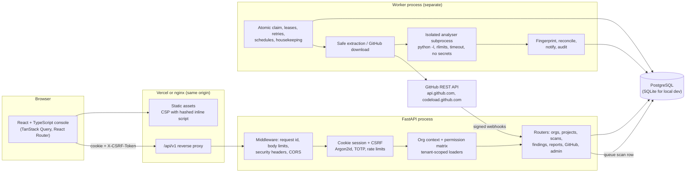
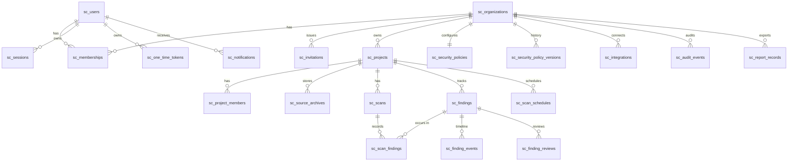

# SecurCode platform architecture

This document describes the multi-tenant platform served under `/api/v1` and the TypeScript console. The original single-tenant console and its API are documented in [`../ARCHITECTURE.md`](../ARCHITECTURE.md). They still work unchanged when the database is SQLite.

## System overview



The API never analyses untrusted code. It validates and stores the upload, writes a `queued` scan row and returns `202 Accepted` with the scan id. A separate worker process claims the job and runs the analyser in a further child process.

## Components

| Component | Location | Responsibility |
|---|---|---|
| Settings | `backend/app/v1/settings.py` | Environment configuration that fails closed in production (requires PostgreSQL, an encryption key and secure cookies). |
| Data layer | `backend/app/v1/db.py`, `models.py`, `backend/migrations/` | SQLAlchemy 2 models with the `sc_` table prefix, UTC-aware timestamps, Alembic migrations (version table `sc_alembic_version`). |
| Authentication | `routers/auth.py`, `security.py`, `deps.py` | Registration, login, opaque session cookies, CSRF, lockout, password reset, email verification, TOTP MFA, session management. |
| Tenancy and RBAC | `permissions.py`, `deps.py` | Central permission matrix; `org_context` resolves membership; `get_project/get_scan/get_finding` always filter by `org_id`. |
| Scanning | `services/scanning.py`, `services/archive.py`, `worker.py` | Source preparation, isolated analysis, fingerprinting, lifecycle reconciliation, notifications. |
| Scanner engine | `backend/security_engine/scanner/` | Original AST/lexical rules plus `extended.py` (30 new rules), `rules.py` registry, `runner.py` subprocess entry point. |
| Integrations | `services/github.py`, `routers/github.py` | Token-based GitHub client restricted to two hosts, signed and de-duplicated webhooks, PR status and comment publishing. |
| Reporting | `services/reports.py`, `routers/reports.py`, `routers/analytics.py` | CSV/JSON/SARIF 2.1.0 exports validated against the OASIS schema, SARIF import, printable HTML reports, dashboard analytics, posture score. |
| Audit | `audit.py` | Append-only, hash-chained audit events with request correlation ids. |
| Frontend | `frontend/src/app/` | Code-split React application with dark and light themes; all data comes from `/api/v1`. |

## Request lifecycle

1. The browser calls `/api/v1/...` on its own origin. Vercel rewrites or nginx forward the request to the API, so the session cookie stays first-party (`HttpOnly`, `Secure`, `SameSite=Lax`).
2. Middleware assigns or accepts an `X-Request-ID`, rejects bodies above the per-route limit (1 MB for JSON, the configured archive size for uploads) and adds security headers.
3. `current_auth` looks up the SHA-256 digest of the session token and enforces absolute and idle expiry, account state, pending-MFA state and, for unsafe methods, the session's CSRF token.
4. `org_context` loads the caller's membership in `{org_id}`. Non-members and unknown organisations get the same `404`.
5. Route handlers call `ctx.require(permission)` and load objects only through tenant-scoped helpers. Developers and viewers see only the projects they belong to.
6. Security-relevant changes call `audit.record(...)` in the same transaction.

## Scan pipeline

```mermaid
sequenceDiagram
  participant U as User / GitHub webhook
  participant A as API
  participant D as Database
  participant W as Worker
  participant S as Analyser subprocess
  U->>A: upload archive / start scan / PR event
  A->>D: store archive (bytes in DB), insert scan (queued)
  A-->>U: 202 + scan id (UI polls status)
  W->>D: UPDATE ... SET status=running WHERE id=? AND status=queued
  W->>W: safe extraction into a temp workspace
  W->>S: python -I (rlimits: memory, CPU, files; empty cwd; minimal env)
  S-->>W: JSON findings (paths relative to workspace)
  W->>D: findings upsert by fingerprint, scan occurrences, reconcile lifecycle
  W->>D: status completed / completed_with_warnings / failed / cancelled
  W->>U: notifications (and PR status/comment for PR scans)
```

Key rules:

- **Never execute uploaded code.** Files are read as text. The analyser runs with `python -I` (no `PYTHONPATH`, no user site-packages, no imports from the scanned tree) in an empty working directory, with `RLIMIT_AS`, `RLIMIT_CPU`, `RLIMIT_FSIZE`, `RLIMIT_NOFILE` and a wall-clock timeout. A test plants `json.py`/`sitecustomize.py` in a scanned tree and asserts they are never imported.
- **Never report incomplete scans as clean.** A scan with warnings (skipped files, limits reached, symlinks) or with zero supported files is `completed_with_warnings`. Only a warning-free scan that analysed files can auto-resolve findings.
- **Rule-scoped verification.** A finding is marked `resolved` and `verified_fixed` only when a complete scan ran its rule over the file and did not report it.
- **Jobs survive worker crashes.** Leases are renewed every 2 seconds. Expired leases are requeued up to 3 attempts, then failed with an explanation.

## Multi-tenant data model



Every organisation-owned table carries `org_id` with a foreign key and index; child tables repeat `org_id` so every query can filter on it directly. Important constraints:

- `sc_memberships (org_id, user_id)`, `sc_projects (org_id, slug)` and `sc_findings (project_id, scope_key, fingerprint)` are unique.
- Status, role and severity columns have `CHECK` constraints.
- Organisation deletion cascades. Users are referenced with `SET NULL`, so history survives when an account is removed.
- `sc_webhook_deliveries.delivery_id` is unique, which provides webhook replay protection.
- `sc_scans.idempotency_key` is unique and prevents duplicate scans from retries, schedules and webhooks.

Other tables: `sc_rate_events` (cross-replica rate limiting), `sc_worker_heartbeats` (worker health), `sc_notification_preferences`, `sc_webhook_deliveries`.

## Repository structure (platform parts)

```
backend/
  app/main.py                 FastAPI app: legacy routers (SQLite only) + /api/v1
  app/v1/                     multi-tenant platform (settings, db, models, deps, routers/, services/, worker.py, cli.py)
  migrations/                 Alembic (sc_* tables only)
  security_engine/scanner/    engine.py, python.py, javascript.py (original rules), extended.py, rules.py, runner.py
  tests_v1/                   platform tests (auth, tenancy/IDOR sweep, workflow, archive safety, integrations)
  conftest.py                 isolates every test run from real databases
frontend/
  src/app/                    TypeScript console (pages/, components/, lib/)
  src/main.jsx                legacy console (served at /legacy.html)
  test-app/                   Vitest + Testing Library
  e2e-platform/               Playwright journey against the real API and worker
scanner-fixtures/             benchmark fixtures and demo projects (intentionally vulnerable)
docs/                         architecture, security, scanner, deployment, testing, api
.github/workflows/            platform-ci.yml, deploy.yml, security-check.yml, codeql.yml
```

## Legacy compatibility

- `legacy_api_enabled()` keeps the original endpoints (`/scan`, `/projects`, `/findings`, ...) and their bearer-token authentication working whenever the database is SQLite. With PostgreSQL they are off unless `SECURCODE_LEGACY_API=true`.
- New tables live in the same SQLite file, so `python -m app.v1.cli migrate` is additive. `python -m app.v1.cli import-legacy` copies legacy users (with their scrypt hashes, upgraded to Argon2id at first login), projects, scans and findings into a "Legacy workspace" organisation without modifying legacy tables.
